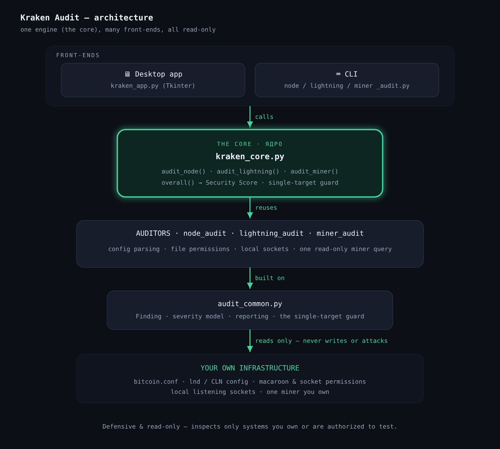
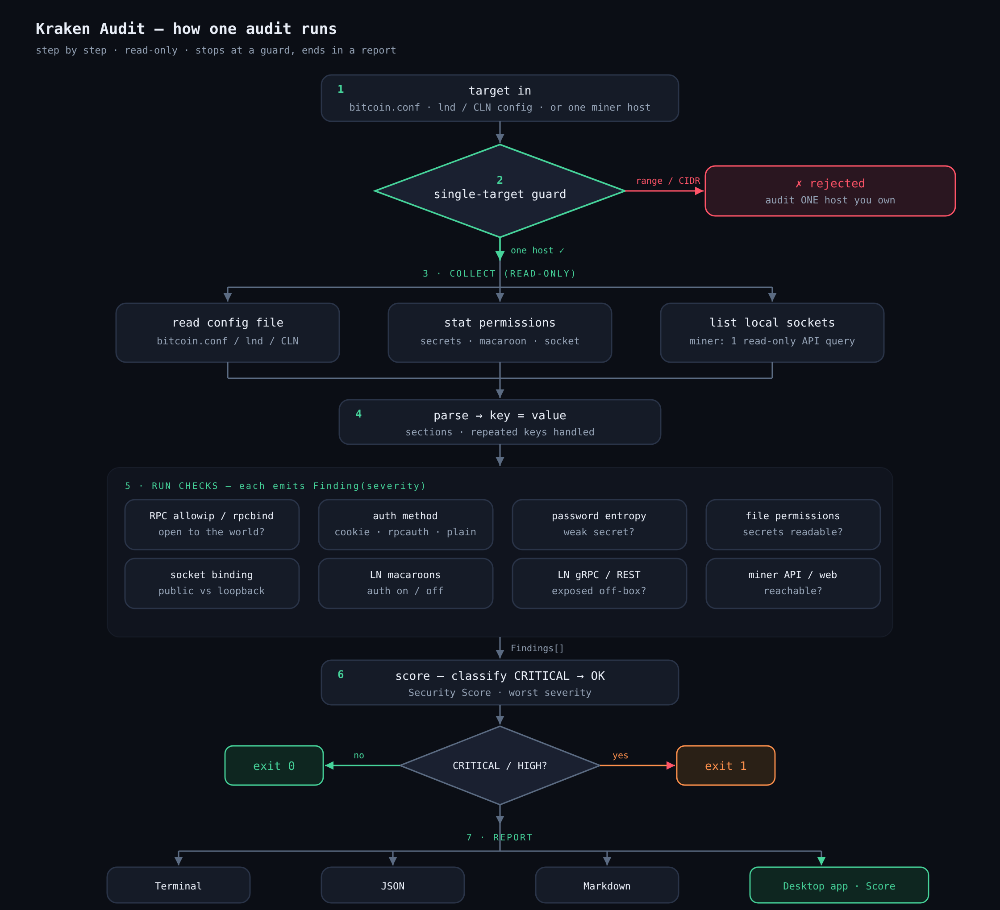
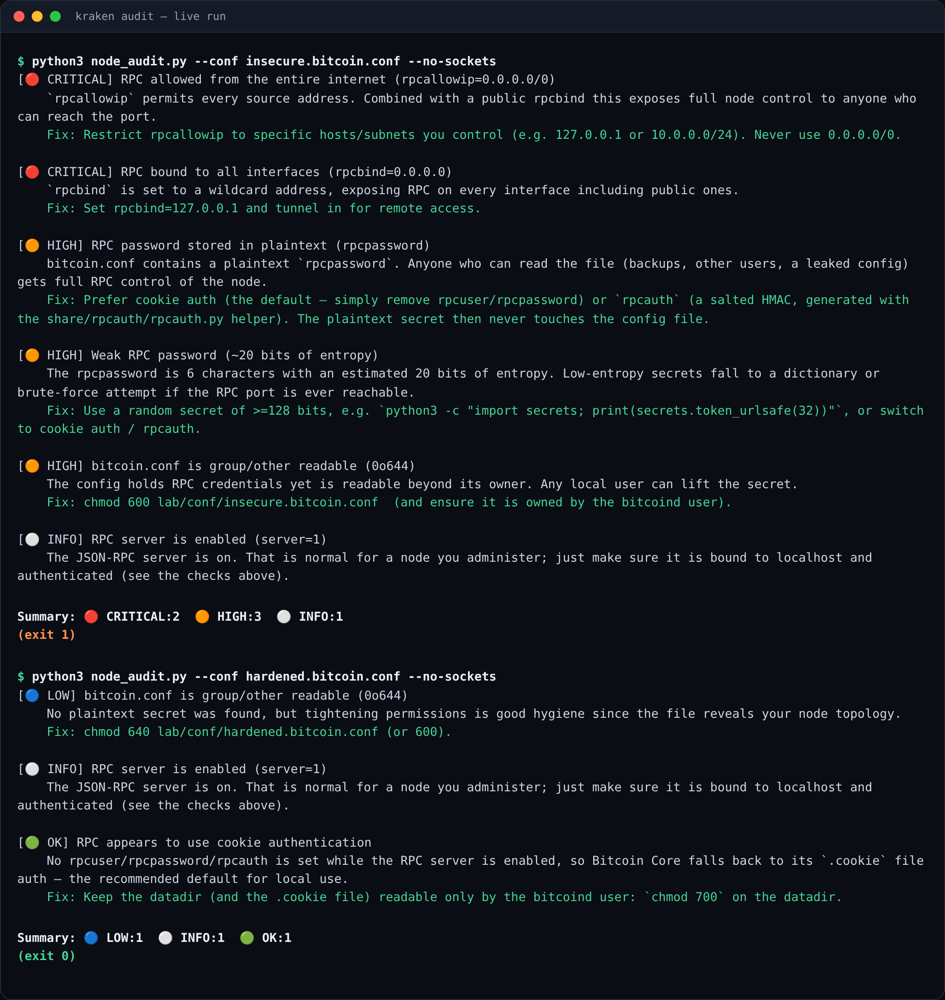
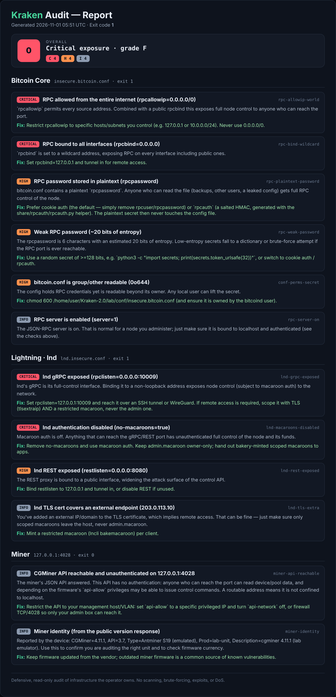

# Docs

Diagrams and sample output for the Kraken Audit toolkit.

## Architecture

One engine (the core), many front-ends — all read-only.

## How one audit runs

Step by step: input → single-target guard → read-only collect → parse → checks
→ score → report. The red branch (guard) and the exit codes show where the
process stops.

## Sample run

`node_audit.py` on an insecure config (findings + fixes, exit 1) and on a
hardened one (clean, exit 0):

## Sample combined report

`kraken_report.py` gathering Bitcoin Core, Lightning and a miner into one
document with an overall Security Score:

